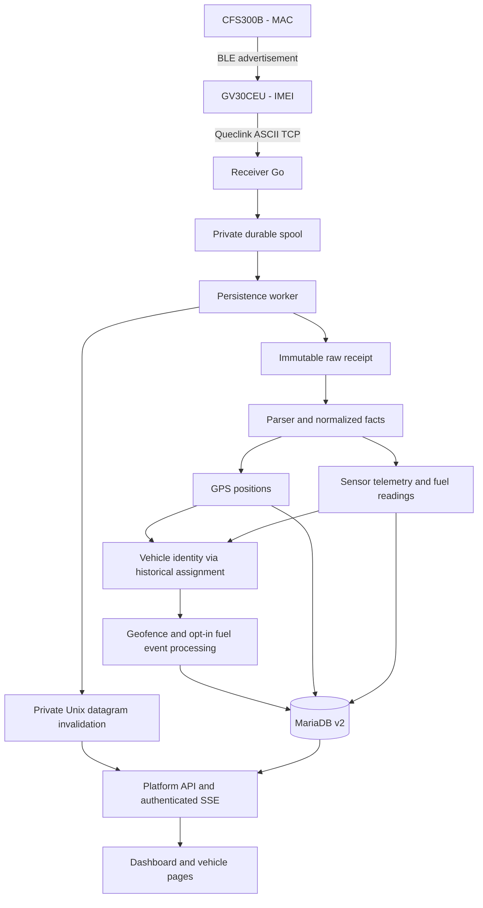
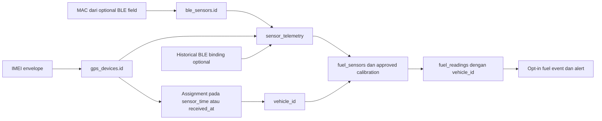

# Phase 1 — Audit Existing System for Vehicle-Centric Alert Engine

Tanggal: **5 November 2026, WIB**. Project: PasTrack, Golang dan MySQL/MariaDB.

Audit ini mencakup source lokal, migration, dokumentasi deployment, metadata dan agregat database live, serta health endpoint privat. Semua akses server/database bersifat baca; transaksi SQL eksplisit `READ ONLY` kemudian rollback. Tidak menjalankan aplikasi, migration, seed, replay TCP, login, mutation API, atau deployment. File yang dibuat hanya dokumen audit dan lampirannya.

**Kesimpulan:** fondasi vehicle-centric sudah tersedia, terutama GPS berdasarkan histori assignment. Belum ada Centralized Alert Engine yang lengkap. Jalur fuel, sensor identity, waktu kejadian, dan ignition membutuhkan keputusan desain sebelum implementasi. **Vehicle harus tetap menjadi identitas alert; IMEI/MAC hanya identitas sumber.**

Status bukti dibedakan: **source** = perilaku kode lokal; **live** = hasil pembacaan saat audit; **historis** = catatan deployment, bukan pengujian ulang. Binary live belum dibandingkan hash dengan hasil build source lokal, sehingga perilaku source tidak otomatis merupakan bukti setiap jalur telah dieksekusi di produksi.

## 1. Existing System Architecture

Ada dua generasi aplikasi di workspace:

| Bagian | Entry point / lokasi | Peran |
|---|---|---|
| Receiver Go | `main.go`, package main di root | TCP Queclink, durable spool, worker normalisasi, health dan realtime publisher |
| Platform v2 | `cmd/pastrack-local/main.go`, `internal/platform/` | HTTP net/http, autentikasi, API `/api/v1`, dashboard embed, laporan, fleet, inventory, fuel dan trip |
| Web lama | `web/main.go`, `web/controllers/`, `web/models/` | Modul Go terpisah berbasis Beego; memuat worker notifikasi lama |
| Receiver lama | `pastrack.py` | Referensi legacy/rollback, bukan target penambahan engine |
| Domain library | `internal/protocol`, `fuel`, `trip`, `geofence`, `remoteoutput` | Decoder dan logika domain |
| Database | `database/schema.json`, `database/migrations/`, `internal/database/` | Definisi skema v2 dan mekanisme migration; tidak dijalankan saat audit |
| Frontend aktif v2 | `internal/platform/ui/` | JavaScript biasa, layout Stitch, Leaflet, aset embed; bukan frontend SPA framework terpisah |
| Operasional | `deploy/`, `scripts/`, `.local/`, `docs/` | Deployment, startup lokal, tunnel live dan bukti pemeriksaan terdahulu |

Dependency root mencakup MySQL driver, bcrypt/crypto, PDF dan Excel; `go.mod` meminta Go 1.25. README root masih menyebut kemampuan BLE belum diimplementasikan dan Beego sebagai dashboard utama. Itu sudah tertinggal dibanding source v2 dan catatan cutover 3 November.

Live saat audit: receiver health `schema=v2`, `status=ok`, `queued=0`; web health `schema=v2`, `status=ok`, `read_only=false`, `physical_ignition=NOT_INSTALLED`. Database aktif `pastrack_v2_20261103_r2`. Catatan cutover menunjuk environment privat `/etc/pastrack/v2-live.env`, receiver `/opt/pastrack/pastrack`, web `/www/wwwroot/pastrack/pastrack-web`; port TCP 5001 dan loopback health 18087/web 18089. Environment lama `/opt/pastrack/.env` tidak boleh dianggap konfigurasi v2 otoritatif.

Tidak ditemukan Redis, Kafka, RabbitMQ, atau broker eksternal dalam jalur v2 yang diperiksa. Queue penerimaan adalah file spool lokal; SSE adalah invalidation UI, bukan durable event bus.

## 2. Existing Database Schema

Metadata live berisi **71 tabel / 656 kolom**; inventaris lengkap tersedia di [lampiran skema](ALERT-ENGINE-PHASE1-SCHEMA-2026-11-05.md) dan [bukti agregat/metadata JSON](ALERT-ENGINE-PHASE1-SCHEMA-2026-11-05.json). Tidak ada payload mentah, password, token, IMEI atau MAC aktual yang disalin ke lampiran.

| Kelompok | Tabel dan fungsi |
|---|---|
| Kendaraan | `vehicles` (PK id, pelat unik, physical ignition), `vehicle_types`, `vehicle_groups`, `vehicle_group_members`, `vehicle_assets`, `vehicle_inventory` (kode, kapasitas, foto) |
| GPS inventory | `gps_devices` (IMEI unik), `gps_device_models`, `vehicle_assignments` (device_id → vehicle_id, starts_at/ends_at, provenance) |
| GPS operasional | `gps_device_status`, `gps_device_configurations`, `gps_device_command_logs`, `remote_output_commands` |
| Receipt dan parser | `device_raw_messages`, `protocol_message_types`, `protocol_parse_logs`, `protocol_parser_errors`, `message_processing_keys` |
| Posisi dan status | `gps_positions`, `latest_positions`, `gps_quality_logs`, `device_status_logs`, `network_status_logs` |
| Trip | `trips`, `trip_segments`, `trip_events` |
| BLE | `ble_sensors` (sensor_identifier dan MAC unik), `ble_sensor_bindings`, `sensor_telemetry`, `ble_connection_logs`, `ble_sensor_status`, `sensor_reported_names` |
| Fuel | `fuel_sensors`, `fuel_tank_profiles`, `fuel_calibrations`, `fuel_calibration_points`, `sensor_calibration_sessions`, `fuel_readings`, `latest_fuel_readings`, `fuel_events`, `fuel_event_investigations`, `fuel_consumption_summaries` |
| Event dan geofence | `event_types`, `event_severities`, `device_events`, `event_acknowledgements`, `geofences`, `geofence_vehicle_assignments`, `geofence_events` |
| Alert dan delivery | `alert_rules`, `alert_events`, `notification_channels`, `alert_notifications`, `notifications`, `push_tokens`, `push_jobs` |
| Identitas dan audit | `users`, `roles`, `permissions`, `user_roles`, `role_permissions`, `sessions`, `audit_log` |
| Laporan dan lokasi | `report_jobs`, `report_schedules`, `tracking_places`, `tracking_geocode_cache`, `tracking_geocode_usage` |
| Migration | `migration_batches`, `migration_record_map`, `stage_migration_steps` |

Relasi penting menurut migration: GPS position membawa device_id, vehicle_id, assignment_id dan raw_message_id. Sensor telemetry membawa sensor_id, device_id, binding_id dan raw_message_id, **tanpa vehicle_id langsung**. Fuel reading membawa vehicle_id, telemetry_id, fuel_sensor_id dan calibration_id. Alert membawa vehicle_id serta tautan optional ke device/fuel/geofence event. `alert_events.vehicle_id` masih nullable: skema belum menjamin semua alert beridentitas kendaraan.

Migration menyediakan FK, pemeriksaan rentang koordinat/fuel, interval assignment, unique receipt, raw/sample ordinal, raw/accessory index dan dedup derived event. Indeks histori utama meliputi `(vehicle_id,gps_time,id)`, `(device_id,received_at,id)`, `(sensor_id,received_at,id)`, `(vehicle_id,reading_at,id)` dan `(device_id,starts_at,ends_at)`. **Seluruh indeks/FK live belum dibandingkan satu per satu dengan migration**; metadata kolom telah dibaca langsung. Indeks fuel berbasis reading_at perlu ditinjau karena jalur sekarang banyak membaca received_at.

Snapshot live, bukan angka permanen:

| Pemeriksaan | Hasil |
|---|---:|
| Kendaraan / GPS / BLE sensor | 2 / 2 / 2 |
| GPS positions | 14.581 |
| Posisi tanpa vehicle_id | 857 |
| Posisi tanpa gps_time | 0 |
| Histori GPS assignment / interval tertutup | 2 / 0 |
| Pasangan interval overlap pada device yang sama | 0 |
| Fuel readings | 12.752 |
| Fuel valid / uncalibrated / out_of_range | 11.230 / 1.468 / 54 |
| Fuel tanpa reading_at / tanpa vehicle_id | 12.752 / 27 |
| Alert rules / alert events | 0 / 0 |
| Notifications / push jobs | 1 / 0 |
| Kendaraan physical ignition NOT_INSTALLED | 2 |

Penyebab setiap baris tanpa vehicle_id belum ditelusuri satu per satu. Catatan cutover pernah menyebut 99 posisi unresolved; angka live sekarang 857 sehingga angka historis tidak boleh digunakan sebagai keadaan terkini. Tidak dilakukan backfill.

## 3. GPS Data Flow

1. `handle/readFrame` menerima ASCII hingga `$`; mendukung frame terpecah dan beberapa frame per koneksi, batas 60.000 byte, idle deadline 300 detik, maksimum 256 koneksi bersamaan.
2. `enqueue` memberi receipt ID acak, menyimpan payload bytes dan received_at UTC, menulis file privat, fsync file, rename dan fsync direktori sebelum worker dibangunkan.
3. `save` memilih legacy/v2 menurut `PASTRACK_SCHEMA`; v2 menggunakan `saveV2`.
4. Parser memisahkan RESP/BUFF dan menyimpan ACK/SACK tanpa mengarang posisi. GTSTT yang diverifikasi mencakup protocol `80201E0100`/`80201E0306`; GTERI ditangani decoder terpisah. Layout/mask di luar cakupan dipertahankan sebagai raw, bukan ditebak.
5. IMEI → `gps_devices.id` hanya perangkat aktif dan belum dihapus. IMEI tidak dikenal tetap punya receipt, tidak otomatis mendapat posisi atau vehicle.
6. Receipt immutable di-commit lebih dahulu; normalisasi dalam transaksi berikutnya. Parse log versioned; receipt ID mencegah replay spool menggandakan receipt yang sama. Processing key hash menormalkan prefix BUFF menjadi RESP untuk menekan derived facts duplikat.
7. Untuk setiap posisi, cari assignment pada **gps_time** dengan interval `[starts_at, ends_at)`. Tidak memakai kendaraan saat ini sebagai pengganti histori yang hilang. Overlap menghasilkan normalization blocked; spool `.blocked` dipertahankan.
8. Simpan GPS time, device send time, received_at dan lineage. `latest_positions` maju menurut GPS time, kemudian received_at untuk seri waktu yang sama; row kendaraan dikunci.
9. Posisi valid dan ber-vehicle dipakai untuk geofence. Paket lebih lama dari posisi terbaru tidak memunculkan current crossing; gap lebih dari 5 menit juga ditekan. Tidak otomatis membuat alert geofence.
10. Setelah commit/penghapusan spool, realtime invalidation dikirim ke web dan SSE. Ini meminta UI membaca keadaan terbaru.

**Late/out-of-order:** histori GPS diterima tanpa mengganti latest dengan event lebih tua. Belum ada watermark generik, kebijakan future-time generik untuk semua rule, atau replay alert tersentralisasi. Dedup payload bukan dedup semantik semua kejadian. Parser version dan processing key perlu diperhatikan bila kelak melakukan reprocessing karena hash pesan unik tidak otomatis menghasilkan fakta baru untuk parser baru.

## 4. BLE Data Flow

`internal/protocol/eri.go` menerima GTERI protocol v0306 dengan section mask yang dikenal (`0x100` / `0x8104`), posisi dan optional accessory fields. CFS300B dikenali type 27/model 0. Lima byte hex dipecah sebagai tilt 1 byte, fuel height 2 byte big-endian, volume 2 byte big-endian. **Raw height/volume bukan otomatis cm, liter atau persen.** MAC dinormalisasi uppercase 12 hex; nama/index accessory tidak dijadikan identitas pengganti.

Jika MAC kosong, raw tetap disimpan tetapi sensor telemetry untuk accessory tersebut dilewati. Sensor dengan MAC valid ditemukan/dibuat otomatis; reported name disimpan terpisah. `persistBLE` menyimpan payload_hex, mask, decoder_version, battery/temperature/status jika tersedia. RSSI punya kolom tetapi decoder yang ditinjau tidak mengisi nilainya; jangan membuat rule RSSI seolah datanya pasti ada.

**Sumber vehicle aktual:** GPS yang menerima report → assignment pada `sensor_time`, atau **received_at jika sensor_time kosong**. `ble_sensor_bindings` hanya metadata historis optional dan tidak mengalahkan GPS penerima. Maka ini belum merupakan resolver sensor→vehicle independen. Overlap GPS assignment menandai ambiguous; tidak ada assignment menghasilkan fuel vehicle NULL. Ketidakcocokan administrative binding dengan kendaraan gateway tidak otomatis menjadi penolakan semua telemetry.

Sensor status/latest fuel maju menurut **received_at**. `fuel_readings.reading_at` hanya diisi optional sensor_time. Seluruh reading_at live kosong saat audit; waktu posisi dari raw yang sama masih dapat menjadi bukti waktu pengukuran pada jalur frontend/fleet, tetapi writer fuel tidak menyimpannya sebagai reading_at. Paket buffered sebelum transfer dapat salah diasosiasikan ke kendaraan baru ketika fallback menggunakan waktu penerimaan.

Fuel percentage **sudah tersedia**, bukan perlu dibuat dari nol. `internal/fuel/calibration.go` melakukan interpolasi linear antar titik approved calibration, kemudian `percent = 100 × liters / capacity_l`. Syarat: media fuel_tank, input raw yang dikenal, kapasitas positif, minimal dua titik strictly monotonic, output liters, calibration efektif dan tank milik vehicle yang cocok. Raw di luar titik → out_of_range; tanpa approval → uncalibrated. `last_valid_reading_id` dipisahkan dari pengamatan terbaru. Ada alur manual dan sesi automatic empty/full dengan pemeriksaan kestabilan; keberadaan 11.230 valid reading membuktikan hasil konversi tersimpan, **bukan validasi akurasi fisik tangki**. Tidak dilakukan pengujian hardware/kalibrasi ulang.

## 5. Vehicle-Device Relationship

| Pertanyaan | Jawaban audit |
|---|---|
| Bagaimana data dikenali sebagai milik kendaraan? | GPS melalui device ID + histori assignment pada GPS time; fuel melalui sensor MAC→sensor ID dan GPS penerima→histori assignment, dengan fallback waktu penerimaan |
| Satu kendaraan bisa beberapa perangkat? | Skema mendukung beberapa GPS assignment dan beberapa BLE; tidak ada unique current-device per vehicle pada migration. API assignment umum hanya memeriksa overlap device; alur connect/transfer lebih ketat. Fleet memilih satu assignment GPS terbaru dan satu fuel reading terbaru, sehingga dukungan multi-device belum konsisten end-to-end |
| GPS bisa dipindahkan? | Ya. `transferGPS` mendukung move/swap, menutup assignment lama dan membuat yang baru dalam transaksi; memeriksa expected relation dan future assignment |
| Ada histori pasang/lepas? | Ya, starts_at/ends_at/provenance pada GPS dan BLE binding. Live memiliki 2 assignment GPS, belum ada yang tertutup; kemampuan histori tidak sama dengan bukti transfer pernah digunakan |
| Pelepasan/penghapusan? | Inventory deletion memakai soft-delete dan penutupan relasi terkait; future assignment dapat menghalangi operasi. Tidak ditemukan endpoint unbind tersendiri pada jalur yang diperiksa; assignment API umum GET/POST, bukan editor ends_at existing |
| Registrasi BLE? | Berdasarkan sensor yang benar-benar diamati GPS; browser tidak bebas menetapkan gateway. Registrasi menghubungkan vehicle, gateway, sensor dan tank. UI sensor juga mengambil gateway terbaru dari telemetry |
| BLE ikut pindah saat GPS transfer? | Atribusi runtime mengikuti GPS; jangan menganggap historical binding dan tank/calibration otomatis konsisten setelah transfer. Tank mismatch menekan konversi menjadi uncalibrated, tetapi kebijakan kepemilikan sensor perlu ditetapkan |

**Ignition:** kedua kendaraan live `NOT_INSTALLED`, sesuai informasi wiring pengguna. Decoder mengenal GTIGL/GTIGN/GTIGF serta virtual GTVGL/GTVGN/GTVGF. `classifyFleet` tetap dapat mengisi `ignition_status` ON/OFF dan mempertahankan last report sampai event berikutnya tanpa gate `physical_ignition_state`. `mapIgnitions` juga membaca report historis. Jadi report protokol/virtual bukan bukti kabel ignition terpasang. MOVING/STOPPED berasal dari kecepatan/freshness GPS dan tidak boleh dipakai sebagai hardware ignition. Engine mendatang harus memakai UNKNOWN/NOT_AVAILABLE untuk physical ignition saat belum terpasang; rule idle/engine-off harus dinonaktifkan atau ditandai tidak tersedia.

## 6. Existing Alert/Notification Capability

| Kemampuan | Keadaan source / live |
|---|---|
| Rule registry | Tabel dan API `alerts/rules` ada; live 0 rule |
| Fuel detection | Inline dalam transaksi ingestion untuk enabled fuel_drop/refueling; minimum samples, delta, max gap, confirmation, optional require_stopped |
| Fuel alert persistence | Detector dapat menulis fuel_events lalu alert_events dengan vehicle_id; unique key derived fuel event mencegah pengulangan source window yang sama |
| Fuel sample time | Detector mengambil sensor readings menurut id dan received_at, tanpa filter vehicle_id pada sample query; raw transfer/replay perlu diperhatikan |
| Geofence | Enter/exit event tersedia; belum ditemukan pipeline umum geofence→alert |
| Acknowledge | Endpoint dan UI tersedia; belum ditemukan evaluator lifecycle/auto-resolve umum |
| Notification v2 | Daftar user-scoped dan skema channel/delivery/push ada; tidak ditemukan dispatcher v2 yang menghubungkan setiap alert ke notifications/push jobs |
| Push legacy | Beego memiliki FCM init, token, queue, worker retry, notifikasi uji dan service-worker endpoint. Menggunakan tabel `web_*`; bukan bukti push aktif di runtime v2 |
| Background v2 | Spool worker dan publisher; SSE heartbeat 25 detik, report concurrency slots. Tabel report_schedules ada, tetapi tidak ditemukan runner scheduler v2 pada jalur entry point yang diperiksa |
| Offline/stale | Banyak dihitung saat query fleet dan timer refresh frontend, belum berupa durable timeout alert yang berjalan tanpa traffic |

Live 0 alert dan 0 rule berarti detector alert belum dikonfigurasi; bukan kesimpulan bahwa seluruh domain event tidak ada. Satu notification live juga tidak membuktikan delivery push. Tidak ada pengiriman notifikasi uji selama audit.

## 7. Existing API and Frontend Integration

API v2 memakai session cookie `pastrack_v2_session`, bcrypt, auth_version, peran admin/operator/viewer, JSON bounded dengan unknown-field rejection, origin checks, timeout dan audit log pada sejumlah mutation. Resource berbeda memiliki gate berbeda; jangan menambah rule/delivery tanpa meninjau RBAC spesifiknya.

| Area | Endpoint / resource penting |
|---|---|
| Auth/realtime | `/api/v1/login`, `me`, `logout`, `realtime`; `/healthz` |
| Fleet | `fleet/overview`, `fleet/statistics`, `fleet/live`, `fleet/activity`, `fuel/overview` |
| Kendaraan/GPS | `vehicles`, `devices`, `device-models`, `vehicles/{id}/assignments`, `devices/{id}/connect-vehicle`; subresource vehicle telemetry/positions/trips/events/fuel/devices/calibrations |
| GPS/history | `gps/positions`, alias `gps/history`, `gps/quality`, `devices/health`, `devices/connectivity`, `devices/data-activity`, `devices/raw-messages`, `devices/parse-errors` |
| Sensor/fuel | `sensors`, `sensors/{id}/assignments`, `sensor-telemetry`, `fuel/sensors`, `fuel/readings`, `fuel/events`, `fuel/analytics`, `tank-profiles`, `calibrations` dan points/approve; vehicle ble-options/ble-registration |
| Trip | `trips`, `trips/history`, `trips/summary`, `trips/recalculate` |
| Alert/geofence | `alerts/rules`, `alerts/events`, `alerts/events/{id}/acknowledge`, `events`, `event-types`, `event-severities`, `geofences`, `geofence-assignments`, `geofence-events` |
| Operasional | `notifications`, `reports`, `audit`, `users`; alur khusus fuel investigation, auto calibration, inventory, remote output pada handler masing-masing |

Ini inventaris route source, bukan klaim semua method CRUD aktif pada setiap resource. `resources` menentukan daftar field tulis, required, filter vehicle/time dan akses admin. Sensor POST langsung justru ditolak karena otomatis ditemukan dari GPS.

Frontend shell `index.html` memuat JS embed. `stitch.js` mengatur route/layout, tabel/feed, detail alert dan acknowledge. `vehicles.js`, `trip-history.js`, `fuel-events.js`, `sensor-calibration.js`, `operational-register.js` menangani workspace khusus. `platform.js` juga ada sebagai frontend generik; jangan menganggap semua berkas UI legacy aktif sekaligus. EventSource SSE memicu reload/delta; freshness dapat berubah dengan timer walau tak ada receipt baru. Local-live memakai proxy agar mutation, report dan SSE tetap menuju server otoritatif; **localhost bukan lingkungan aman untuk eksperimen tulis**.

Tidak dilakukan klik browser, visual QA, mutation API, atau acceptance test seluruh halaman. Integrasi dinilai dari source dan health runtime.

## 8. Potential Risks

| Prioritas | Risiko dan bukti | Implikasi untuk engine |
|---|---|---|
| Tinggi | Fuel reading_at kosong seluruh snapshot; resolver fallback received_at | Paket terlambat dapat masuk vehicle/kalibrasi yang salah setelah transfer |
| Tinggi | Sensor ownership mengikuti gateway, binding administrative optional | Sensor terbaca gateway lain dapat teratribusi ke kendaraan lain; perlu policy conflict eksplisit |
| Tinggi | Ignition ON/OFF tidak digate wiring | False idle/engine-off alert; wajib pisahkan physical, virtual, reported dan unknown |
| Tinggi | 857 GPS dan 27 fuel tanpa vehicle_id | Tidak boleh membuat alert vehicle palsu atau fallback kendaraan saat ini; masuk unresolved data-health |
| Tinggi | Fuel window query hanya fuel_sensor_id dan received_at/id | Dapat melintasi kendaraan setelah transfer; false drop/refueling dan sejarah waktu tidak konsisten |
| Sedang | Evaluasi inline dalam transaksi normalisasi | Rule error/slow query menahan normalisasi dan backlog; receipt tetap durable tetapi facts tertunda |
| Sedang | Generic assignment dan dashboard beda asumsi jumlah GPS | Satu current GPS tampil meskipun skema memungkinkan lebih; primary/source policy belum formal |
| Sedang | Spool `.blocked`/`.invalid` dan single ordered retry | Butuh observability dan repair; health queued hanya `.json`, tidak menghitung seluruh quarantine |
| Sedang | SSE tidak durable dan status offline query-driven | Alert offline tidak dapat mengandalkan traffic baru atau browser terbuka |
| Sedang | Belum ada state/cooldown/delivery idempotency generik | Spam, missed recovery dan notifikasi ganda pada retry/restart |
| Sedang | fuel validity valid hanya berarti lolos calibration algorithm | Akurasi fisik, sloshing, tilt, temperatur dan pemasangan belum dibuktikan oleh audit |
| Sedang | README/comment masih menamai v2 isolated dan Beego aktif | Salah entry point, migrasi atau deployment ke generasi yang salah |
| Sedang | Belum parity hash binary/source dan constraint live lengkap | Perlu baseline sebelum Phase 2; health saja tidak menjamin seluruh behavior |

Tidak dilakukan load test atau benchmark query plan; risiko performa di atas adalah kesimpulan desain source, bukan angka latensi terukur.

Logging memakai slog receiver, parse/error tables, audit_log dan optional raw text log. Error sementara mempertahankan spool dan retry; record rusak dipisah `.invalid`, overlap normalisasi `.blocked`. Decoder BLE gagal dapat tetap menghasilkan GPS dari fallback `DecodeERIPositions`; source tidak selalu membuat parser-error detail tersendiri untuk kegagalan accessory ketika GPS sukses. Monitor sukses parser saja tidak cukup untuk kesehatan BLE. Raw text log/payload memuat identitas/lokasi sehingga retensi dan akses perlu dijaga.

## 9. Missing Components

1. Resolver identitas seragam: historical device/sensor ID→vehicle, source time, assignment/binding evidence, conflict/missing reason; tanpa fallback diam-diam ke current vehicle.
2. Kontrak normalized event: vehicle_id wajib untuk alert domain, device/sensor/raw lineage, event_at, received_at, time_source, quality, parser/rule version.
3. Pemisahan physical ignition capability dari report virtual serta policy rule yang memerlukan hardware.
4. Engine evaluator umum dengan typed rule validation, scope kendaraan/grup, state persisten, hysteresis, cooldown, dedup, recovery/resolve dan late-event policy.
5. Durable outbox/checkpoint dan worker terpisah agar alert/delivery tidak mengganggu ingestion. SSE tidak menggantikan komponen ini.
6. Scheduler/time-based evaluation untuk offline, sensor stale dan absence-of-data; berjalan tanpa browser atau telemetry baru.
7. Dispatcher v2: recipient/channel preferences, retry/backoff, delivery idempotency, failure monitoring dan secrets handling; integrasi FCM legacy harus dipetakan ulang secara sengaja.
8. Operator view untuk unresolved identity, timing quality, quarantine, backlog, failed delivery serta replay dry-run.
9. Uji integrasi terisolasi untuk transfer, out-of-order, replay, multi-source, sensor conflict, restart/crash dan notification exactly-once effect.

Existing schema sudah menyediakan banyak tabel; **jangan membuat ulang tabel paralel sebelum menilai kecocokan dan compatibility-nya**.

## 10. Recommended Implementation Strategy

Rekomendasi ini merupakan rancangan Phase 2, belum dieksekusi.

1. **Tetapkan kontrak bersama pengguna:** vehicle sebagai aggregate utama, primary GPS bila lebih dari satu, ownership BLE ketika gateway berbeda, precedence event time, toleransi keterlambatan, scope rule, channel dan penerima. Hardware ignition tetap tidak tersedia.
2. **Baseline produksi:** konfirmasi source↔binary, constraint/index aktual, sample raw berizin dan lineage waktu. Telusuri penyebab unresolved identity; jangan backfill otomatis dari assignment sekarang.
3. **Resolver read-only terlebih dahulu:** gunakan GPS time untuk GPS; sensor_time jika terpercaya, lalu bukti GPS dari raw yang sama jika semantik cocok; jika waktu tidak dapat dipastikan, hasil unresolved/time-quality rendah. Jangan menganggap send time selalu waktu pengukuran. Rekam conflict binding versus gateway untuk keputusan policy.
4. **Perluas secara additive:** gunakan tabel rule/event yang ada bila cocok; rancang outbox, evaluator state dan lineage dengan migration yang ditinjau nanti. Jangan mengubah response API lama secara breaking.
5. **Shadow evaluation:** evaluator membaca facts, menghasilkan hasil evaluasi terisolasi tanpa notifikasi atau perubahan operational alert. Bandingkan hasil terhadap GPS/fuel history dan judgement pengguna.
6. **Rule rollout bertahap:** offline/stale berbasis waktu, overspeed berbasis valid GPS, low fuel hanya valid/fresh calibration; fuel drop/refuel mempertahankan stable-window dan dibatasi vehicle serta calibration epoch. Geofence gunakan facts existing. Jangan melabeli fuel_drop sebagai theft terbukti. Idle/engine-off menunggu sumber hardware atau definisi virtual eksplisit.
7. **Delivery sesudah stabil:** outbox→worker→notifications/channel dengan retry dan dedup; acknowledge, resolve dan audit konsisten. UI existing mengonsumsi endpoint compatible; SSE tetap invalidation.
8. **Validasi sebelum rollout:** fixture terisolasi, duplicate RESP/BUFF, packet sebelum/setelah transfer, tidak ada sensor_time, overlap, calibration change, no-fix, future timestamp, DB outage, restart dan missed timer. Phase 2 baru membahas deployment setelah instruksi pengguna; audit ini tidak melakukan deployment.

### Bagian yang harus dilindungi / tidak disentuh untuk membangun engine

Fondasi berikut sudah mempunyai implementasi dan/atau bukti tes yang baik; pertahankan kontraknya. Ini bukan sertifikasi semua edge case produksi:

- TCP framing, batas koneksi/frame dan durable spool/fsync. Jangan mengganti receiver atau menambahkan synchronous delivery ke koneksi tracker.
- Immutable raw receipt, raw bytes, receipt identity, parser logs/version dan dedup normalized facts. Jangan menulis ulang raw history untuk kepentingan alert.
- Historical GPS assignment dan latest-position ordering berbasis GPS time. Jangan menggantinya dengan IMEI→current vehicle lookup.
- Decoder CFS300B raw dan larangan menganggap raw sebagai liter; approved calibration dan last-valid versus latest-observation separation.
- GPS history, trip calculation/history dan playback; engine membaca fakta tanpa menghapus atau menghitung ulang histori secara tidak diminta.
- Geofence geometry dan late-telemetry guard; gunakan existing facts sebelum menduplikasi algoritma.
- Session/RBAC, mask identifier, inventory transfer/audit dan alur BLE registration. Perbaikan policy harus sempit dan direview pada Phase 2.
- Jalur private socket→authenticated SSE dan API/frontend existing. Pertahankan kompatibilitas.
- Database legacy, environment privat, spool produksi, binary/backup rollback serta konfigurasi hardware/remote output. Tidak ada perubahan dalam audit.

### Daftar file penting

| File | Fungsi / alasan dibaca |
|---|---|
| `main.go` | Listener, framing, enqueue, fsync, drain/retry/quarantine, health |
| `parser.go` | Envelope, GTSTT, validasi GNSS/UTC/mask |
| `storage.go` | Pemilihan persistence legacy/v2 |
| `storage_v2.go` | Immutable receipt, dedup, assignment event-time, positions/latest/status |
| `storage_ble_v2.go` | MAC discovery, gateway attribution, telemetry, calibration/fuel persistence |
| `fuel_events_v2.go` | Enabled rule selection, received-time windows, fuel event→alert |
| `geofence_v2.go` | Transition dan late-report guard |
| `realtime.go` | Publisher invalidation receiver |
| `internal/protocol/eri.go`, `cfs300b.go`, `ignition.go` | Decoder dan batas makna hardware |
| `internal/fuel/calibration.go` | Interpolasi/persen, validasi dan stable fuel event detection |
| `internal/trip/engine.go` | Domain perhitungan trip |
| `internal/geofence/geometry.go` | Circle/polygon geometry |
| `internal/platform/server.go`, `api.go` | Auth, routes, resource contract, SSE dan error responses |
| `internal/platform/assignments.go`, `device_transfer.go`, `simple_setup.go` | Histori assignment dan perbedaan jalur connect/move/swap |
| `internal/platform/ble_registration.go` | Observed gateway, vehicle/sensor/tank registration |
| `internal/platform/fleet.go`, `map_telemetry.go` | Status vehicle, freshness, ignition dan historical mapping |
| `internal/platform/calibration.go`, `automatic_calibration.go` | Approval/manual calibration dan stable empty/full session |
| `internal/platform/fuel_events.go` | Workspace/investigation, basis waktu receipt dan evidence |
| `internal/platform/trips.go`, `trip_history.go` | Recalculate dan riwayat API |
| `internal/platform/inventory_delete.go`, `vehicle_inventory.go` | Soft delete, penutupan relasi, vehicle metadata |
| `internal/platform/reports.go`, `live_proxy.go` | Report jobs dan local-live forwarding |
| `internal/platform/ui/index.html`, `stitch.js`, `vehicles.js`, `fuel-events.js` | Shell dan integrasi API/dashboard |
| `internal/remoteoutput/` | Command/control terpisah; jangan jadikan target perubahan alert |
| `database/migrations/001_platform.sql` sampai `009_automatic_sensor_calibration.sql` | Skema, constraints, derived keys dan fitur incremental |
| `web/main.go`, `web/controllers/notifications.go`, `web/routers/router.go` | Runtime/API/FCM legacy; pembanding, bukan engine v2 aktif |
| `storage_v2_test.go`, `internal/protocol/*_test.go`, `internal/platform/*_test.go` | Idempotency, decoder, transfer, identity, API dan calibration test coverage |
| `docs/LIVE_DEPLOYMENT_20261103.md`, `docs/LOCAL_LIVE_DATABASE.md` | Bukti cutover dan peringatan local terhubung live |

### Pengujian dan batas audit

Perintah yang dijalankan: `env -u PASTRACK_TEST_DSN go test ./internal/protocol ./internal/fuel ./internal/trip ./internal/geofence` — **empat package lulus (cached)**. Ini unit test library, tanpa koneksi database. Tes DB/API integration tersedia tetapi tidak dijalankan karena sejumlah tes melakukan DDL/DML/fixture; batas Phase 1 melarang perubahan database. Tidak menjalankan migration tool, script deploy, server aplikasi, atau replay hardware.

Audit bukan penetration test, full browser acceptance, physical calibration validation, benchmark, atau verifikasi seluruh legacy table/row. Yang belum terverifikasi ditandai di atas agar Phase 2 tidak berangkat dari asumsi.

**Phase 1 selesai. Tidak ada implementasi yang dimulai; menunggu instruksi PHASE 2.**
