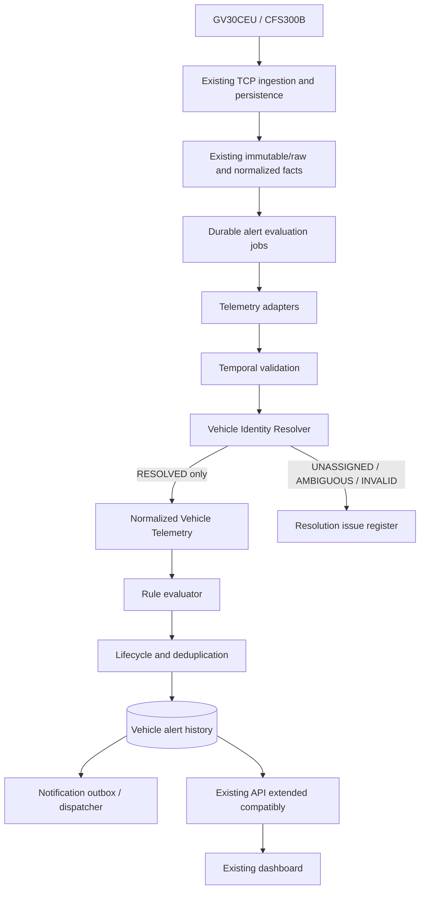
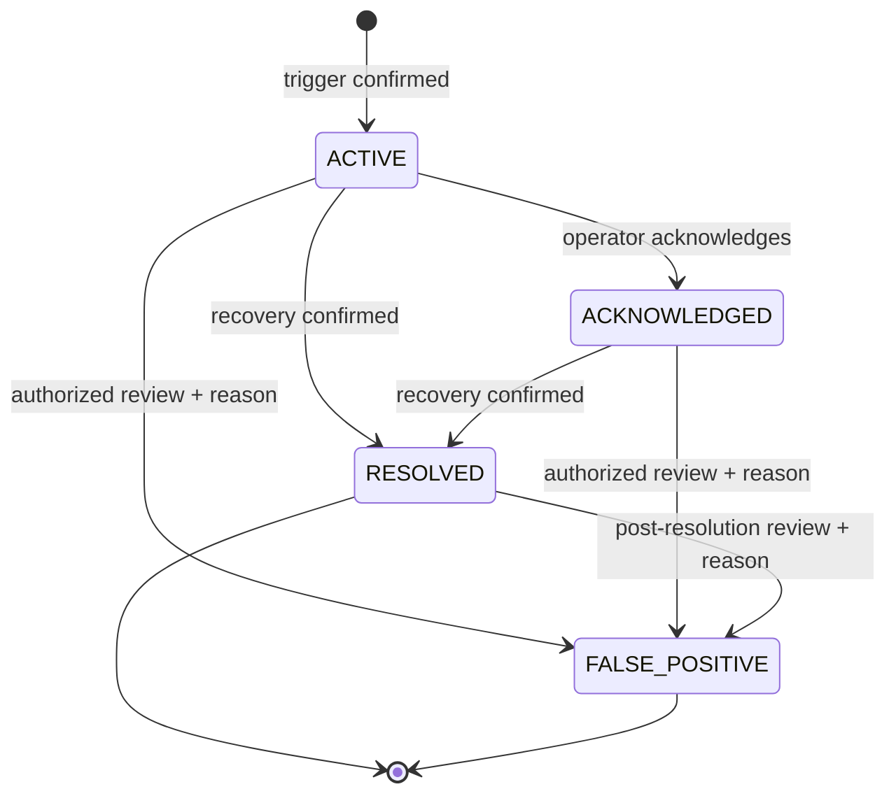
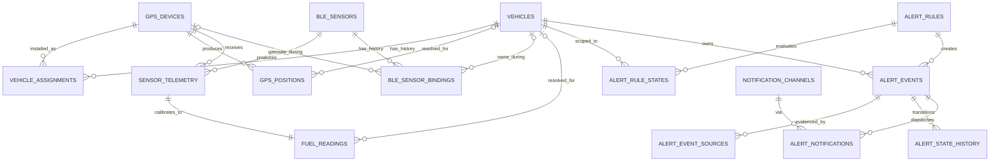

# Phase 2 — Technical Design: Vehicle-Centric Centralized Alert Engine

Tanggal: **5 November 2026 (WIB)**  
Project: PasTrack — Golang, MySQL/MariaDB, Queclink GV30CEU, BLE CFS300B

Dokumen ini adalah desain, bukan implementasi. Audit tambahan dilakukan secara read-only terhadap source, metadata, agregat database live, dan konfigurasi runtime yang sudah diidentifikasi pada Phase 1. Tidak ada source code, database, migration, API, atau deployment yang diubah.

## Executive decision

Centralized Alert Engine harus berada **setelah persistence telemetry existing**, berjalan asynchronous, dan membaca fakta dari tabel existing melalui adapter. TCP receiver tidak menunggu evaluasi rule atau pengiriman notifikasi.

Keputusan identitas:

1. `vehicle_id` adalah aggregate/business identity dan wajib non-null pada setiap alert yang dipublikasikan.
2. IMEI dan MAC hanya mengidentifikasi sumber; keduanya disimpan sebagai lineage melalui internal ID, bukan menjadi pemilik alert.
3. GPS memakai `vehicle_assignments` pada event time.
4. BLE memakai `ble_sensor_bindings` langsung ke vehicle pada event time sebagai relasi otoritatif. Assignment GPS receiver hanya menjadi bukti konteks/gateway dan harus cocok dengan binding; ia tidak otomatis memindahkan kepemilikan sensor.
5. Identity resolution menghasilkan salah satu status: `RESOLVED`, `UNASSIGNED`, `AMBIGUOUS`, atau `INVALID`. Hanya `RESOLVED` yang boleh masuk evaluasi alert kendaraan.
6. Hasil resolusi dan vehicle pada episode alert dibekukan. Reassignment berikutnya tidak mengubah histori alert.
7. Timestamp memiliki sumber dan kualitas eksplisit. `received_at` tidak pernah disamarkan sebagai event time.
8. Ignition fisik tetap `UNKNOWN/NOT_AVAILABLE` selama wiring belum dipasang. Report virtual/protokol tidak boleh mengaktifkan rule yang mengklaim fakta hardware.
9. Rule CRASH berstatus `NOT_READY`: tidak ditemukan decoder/parser crash yang tervalidasi di source saat ini.

## 1. Business architecture



Engine tidak mengubah parser Queclink untuk menyamakan format input. Adapter mengambil fakta yang sudah dipersist: `gps_positions`, `sensor_telemetry`, `fuel_readings`, `device_events`, status device, serta raw lineage bila diperlukan untuk verifikasi.

### Invariants

- Alert yang terlihat oleh API selalu memiliki FK `vehicle_id` valid.
- Sumber alert harus dapat ditelusuri sampai telemetry dan, bila tersedia, `device_raw_messages`.
- Assignment dipilih pada waktu kejadian, bukan pada waktu query dashboard.
- Tidak ada fallback dari histori kosong ke assignment aktif sekarang.
- Reprocessing bersifat idempotent dan tidak membuat episode kedua untuk kondisi yang sama.
- Notification failure tidak membatalkan alert dan tidak menghambat ingestion.

## 2. Verified existing constraints

### GPS

`gps_devices.imei` memetakan IMEI ke internal `device_id`. `vehicle_assignments(device_id, vehicle_id, starts_at, ends_at, provenance)` menyimpan histori pemasangan dengan interval half-open `[starts_at, ends_at)`. Writer v2 sudah mencari assignment pada `gps_positions.gps_time` dan menyimpan `vehicle_id` serta `assignment_id` pada posisi.

### BLE/fuel

`ble_sensors.mac` memetakan MAC ke internal `sensor_id`. `ble_sensor_bindings(sensor_id, vehicle_id, device_id, starts_at, ends_at, binding_source)` sudah menyediakan histori hubungan sensor, kendaraan, dan gateway. `sensor_telemetry` menyimpan sensor, GPS receiver, optional binding, raw message, raw fuel values, optional sensor time, dan received time. `fuel_readings` menyimpan hasil kalibrasi, vehicle, calibration, optional reading time, dan received time.

Jalur writer saat ini menentukan vehicle dari assignment GPS receiver pada `sensor_time`, atau `received_at` jika sensor time kosong. Historical binding hanya metadata optional. Desain baru tidak meneruskan fallback ini sebagai otoritas alert.

Snapshot live tambahan menunjukkan satu binding BLE terbuka, tanpa overlap. Dari 13.122 fuel readings pada snapshot terakhir, hanya 390 mempunyai `binding_id`; semuanya cocok dengan vehicle, device, dan interval binding. Reading lama tanpa binding tidak boleh dianggap mempunyai direct sensor ownership hanya karena gateway saat ini cocok.

### Ignition

`vehicles.physical_ignition_state` live adalah `NOT_INSTALLED`. Decoder mengenali report ignition fisik/virtual, tetapi fleet view tidak mengunci interpretasinya pada capability wiring. Normalized telemetry harus membedakan:

- `PHYSICAL_VERIFIED`: hanya bila capability terpasang dan report source tervalidasi;
- `VIRTUAL_REPORTED`: report virtual, bukan fakta kabel;
- `PROTOCOL_REPORTED_UNVERIFIED`: report ada tetapi capability tidak tersedia;
- `UNKNOWN`: tidak ada sumber faktual.

Untuk kondisi sekarang, ignition input bagi rule adalah `UNKNOWN`; tidak ada rule awal yang bergantung padanya.

### Alert/API

Tabel `event_types`, `event_severities`, `device_events`, `alert_rules`, `alert_events`, `notification_channels`, `alert_notifications`, `notifications`, `push_tokens`, dan `push_jobs` sudah tersedia. Live belum memiliki event type, severity, rule, atau alert. API existing menyediakan:

- `GET/POST/PUT /api/v1/alerts/rules[/{id}]` melalui generic resource;
- `GET /api/v1/alerts/events[/{id}]` dengan cursor, date, dan `vehicle_id` filter;
- `POST /api/v1/alerts/events/{id}/acknowledge`;
- UI list/detail dan acknowledge;
- user-scoped `notifications` serta authenticated SSE invalidation.

Generic rule mutation saat ini hanya memeriksa field umum; ia belum memvalidasi schema configuration per rule. Acknowledge melakukan update tunggal dan tidak menulis lifecycle history/audit trail khusus.

## 3. Vehicle Identity Resolver

### Resolution result

```text
ResolutionResult {
  status: RESOLVED | UNASSIGNED | AMBIGUOUS | INVALID
  vehicle_id?: uint64
  assignment_id?: uint64
  binding_id?: uint64
  device_id?: uint64
  sensor_id?: uint64
  event_time?: timestamp
  time_source: SENSOR | GPS_SAME_REPORT | DEVICE_SEND | RECEIVED | NONE
  time_quality: VERIFIED | CORRELATED | RECEIVED_TIME_ONLY | UNKNOWN
  reason_code: string
  evidence: bounded structured metadata
}
```

### GPS resolution

1. Resolve IMEI to one active/known `gps_devices.id`; for persisted positions use stored `device_id` and validate that device exists.
2. Require a syntactically and semantically valid `gps_time` for alert-capable GPS facts.
3. Query `vehicle_assignments` where device matches and `starts_at <= event_time` and (`ends_at IS NULL` or `ends_at > event_time`).
4. Exactly one row → `RESOLVED`; zero → `UNASSIGNED`; more than one → `AMBIGUOUS`; missing device/time/FK lineage → `INVALID`.
5. Verify stored `gps_positions.vehicle_id/assignment_id` agrees. A mismatch becomes an identity integrity issue and is not silently replaced.

### BLE resolution

1. Resolve normalized uppercase MAC to one `ble_sensors.id`. Missing MAC remains raw-only and is `INVALID` for vehicle alerts.
2. Establish event time and quality using the temporal policy below.
3. Query `ble_sensor_bindings` for `sensor_id` at event time.
4. Exactly one binding with non-null vehicle → candidate direct ownership.
5. Resolve the reporting GPS receiver to its assignment at the same event time. If binding has a `device_id`, it must equal the receiver. If receiver vehicle exists, it must equal the binding vehicle. A mismatch is `AMBIGUOUS` with `BINDING_GATEWAY_CONFLICT`.
6. No direct binding → `UNASSIGNED` with a possible `GATEWAY_CONTEXT_ONLY` candidate recorded as evidence, never promoted automatically to vehicle ownership.
7. More than one active binding → `AMBIGUOUS`.

This uses the direct BLE→vehicle relationship already present in the schema and keeps `device_id` as validated transport context. It avoids making sensor ownership move automatically whenever a GPS is moved.

### Reassignment and late events

- GPS move/swap and BLE install/remove close the old interval and open a new interval in one transaction.
- Late telemetry is resolved using event time. It remains attached to the vehicle whose interval covered that event.
- If only received time is available, resolver may report the vehicle at receipt as context, but `time_quality=RECEIVED_TIME_ONLY`; it may not claim historical ownership across a transfer.
- Assignment boundaries are half-open. An event exactly at `ends_at` belongs only to the next interval if one begins there.
- Any overlap fails closed as `AMBIGUOUS`; it is an operational data issue, not a tie resolved by latest ID.

## 4. Analysis and reconciliation of 857 GPS positions

Read-only classification of all 857 rows:

| Evidence | Result |
|---|---:|
| Has `device_id` and matching device record | 857 |
| Has IMEI through device record | 857 |
| Has `gps_time` | 857 |
| Has raw message lineage | 857 |
| Exactly one assignment at GPS time | 0 |
| No assignment at GPS time | 857 |
| Multiple assignments at GPS time | 0 |
| Occurred before first assignment of the device | 857 |
| Device was never assigned | 0 |
| GTERI / GTSTT | 802 / 55 |

Range waktu kejadian yang ditemukan adalah 4 November 2026 07:59:35–10:26:33 UTC. Assignment pertama untuk device terkait baru berlaku setelah posisi tersebut. Semua row mempunyai sumber cukup untuk membuktikan device dan waktu, tetapi tidak mempunyai bukti hubungan kendaraan pada waktu kejadian.

Klasifikasi:

| Kategori | Jumlah | Dasar |
|---|---:|---|
| Recoverable | **0** | Tidak ada exact historical assignment |
| Unassigned | **857** | Device/time valid, tetapi tidak ada interval assignment |
| Ambiguous | **0** | Tidak ada lebih dari satu candidate |
| Invalid | **0** | Device, IMEI, time, dan raw lineage tersedia |

Estimasi aman yang dapat direkonsiliasi otomatis berdasarkan database saat ini adalah **0 dari 857**. Kesimpulan ini dapat berubah hanya bila ada bukti eksternal yang sah—misalnya berita acara pemasangan dengan waktu efektif—yang membuktikan assignment memang dimulai lebih awal.

### Reconciliation strategy

1. Buat laporan kandidat read-only per device dan interval, tanpa vehicle suggestion dari current assignment.
2. Jika dokumen pemasangan tersedia, operator mengajukan koreksi assignment effective time dengan actor, reason, dan evidence reference.
3. Jalankan dry-run yang menunjukkan posisi mana yang akan cocok dan memastikan tidak menimbulkan overlap.
4. Perubahan assignment/backfill, bila kelak disetujui, harus transactional dan hanya mengisi row yang tepat pada interval; jangan mengubah koordinat, raw receipt, atau trip.
5. Trip lama tidak dihitung ulang otomatis. Dampak terhadap trip dilaporkan terpisah untuk persetujuan eksplisit.
6. Tanpa evidence, 857 row tetap `vehicle_id NULL`, queryable sebagai data-health issue dan tidak eligible untuk alert kendaraan.

## 5. Temporal design for fuel readings

### Current evidence

Populasi live bertambah saat audit karena ingestion aktif: 12.752 pada Phase 1 dan 13.122 pada snapshot terakhir Phase 2. Karena itu angka harus selalu diberi `as_of` pada laporan rekonsiliasi.

Pada pemeriksaan mendalam:

- seluruh reading yang diperiksa mempunyai `reading_at NULL`, `sensor_time NULL`, dan `device_raw_messages.device_time NULL`;
- seluruhnya berasal dari GTERI;
- 12.815 pada snapshot antara mempunyai tepat satu GPS position/time dari raw GTERI yang sama dan device send time;
- 300 reading tidak mempunyai GPS position dari raw yang sama, walaupun diterima dan diproses;
- 4.634 GPS-correlated candidates tiba dalam 5 menit dari GPS time, sedangkan 8.176 tiba lebih dari 5 menit setelah GPS time; 7.134 lebih dari satu jam;
- 12.783 reading mempunyai exact vehicle assignment pada correlated GPS time dan stored vehicle yang cocok;
- 27 reading tanpa vehicle tidak menjadi recoverable melalui correlated GPS time;
- tidak ada sensor timestamp yang dapat membuktikan waktu pengukuran aktual.

Angka di atas berasal dari snapshot berbeda beberapa detik dan tidak boleh dijumlahkan sebagai satu snapshot statis. Kesimpulan strukturalnya stabil: source sensor time tidak tersedia, sebagian besar GTERI membawa GPS time yang berkorelasi, dan banyak paket terlambat/buffered.

### Temporal model

| Field | Makna |
|---|---|
| `event_time` | Waktu kejadian yang dipilih normalizer untuk ordering/evaluation, dengan source dan quality |
| `received_at` | Waktu frame diterima server; fakta transport, selalu dipertahankan |
| `processed_at` | Waktu parser/normalizer/evaluator memproses fakta |
| `reading_at` | Waktu pengukuran sensor yang telah tervalidasi; tetap NULL bila belum terbukti |

Timestamp quality order:

1. `VERIFIED_SENSOR_TIME`: timestamp optional BLE tervalidasi dan masuk batas waktu yang wajar.
2. `CORRELATED_GPS_SAME_REPORT`: satu GPS time valid dari raw GTERI yang sama, device/send ordering wajar, tidak future, dan lineage tepat satu.
3. `DEVICE_SEND_TIME_ONLY`: send time valid tetapi bukan measurement time.
4. `RECEIVED_TIME_ONLY`: hanya received time.
5. `UNKNOWN`: tidak ada candidate layak.

`CORRELATED_GPS_SAME_REPORT` boleh menjadi normalized `event_time`, tetapi tidak otomatis mengisi `reading_at`; ia bukan timestamp asli CFS300B. Pengisian `reading_at` historis hanya boleh dilakukan setelah kebijakan bisnis secara eksplisit menerima GPS-same-report sebagai waktu ukur tervalidasi, dan harus menyimpan `reading_time_source/quality` serta evidence. Hingga itu terjadi, nilai historis tetap NULL.

### Historical strategy

- Fuel percentage/liter existing tetap digunakan; tidak ada kalibrasi baru.
- Reading `VERIFIED_SENSOR_TIME` eligible untuk seluruh rule fuel.
- `CORRELATED_GPS_SAME_REPORT` dapat dipakai untuk shadow evaluation FUEL_LOW dan FUEL_DROP, tetapi produksi FUEL_DROP baru diaktifkan setelah hasil validasi terhadap sample raw/hardware diterima. Kebijakan default fail-closed: FUEL_DROP production membutuhkan `VERIFIED` atau rule version yang secara eksplisit mengizinkan `CORRELATED`.
- `DEVICE_SEND_TIME_ONLY`, `RECEIVED_TIME_ONLY`, dan `UNKNOWN` tidak eligible untuk interval FUEL_DROP.
- FUEL_LOW dapat memakai received-time-only hanya untuk kondisi live yang dibuktikan `+RESP`/non-buffered, fresh, binding stabil, dan beberapa reading berurutan; historical replay tidak boleh membuat low-fuel alert berdasarkan receipt lama.
- Jangan mass-update `reading_at`; gunakan reconciliation report/dry-run dan simpan evidence bila kelak ada backfill terotorisasi.

## 6. Normalized Vehicle Telemetry

Normalized telemetry adalah Go value/envelope yang dibentuk adapter, bukan pengganti tabel telemetry existing.

```text
VehicleTelemetry {
  schema_version
  kind: GPS_POSITION | FUEL_READING | DEVICE_EVENT | DEVICE_STATUS | POWER | IGNITION
  vehicle_id
  event_time
  received_at
  processed_at
  time_source
  time_quality
  identity_status
  device_id?
  sensor_id?
  assignment_id?
  binding_id?
  raw_message_id?
  source_table
  source_id
  quality { validation_state, fix_status, calibration_id, ... }
  values { typed fields for kind }
}
```

| Kind | Values | Minimum eligibility |
|---|---|---|
| GPS_POSITION | speed, lat/lon, heading, fix | resolved vehicle, verified GPS time, valid fix for speed/location rules |
| FUEL_READING | percent, liters, raw/unit, calibration | resolved direct BLE binding, validity `valid`, approved calibration, time quality declared |
| DEVICE_EVENT | verified event code/value | decoder-supported event, event time and identity resolved |
| DEVICE_STATUS | connectivity/last receive | time-worker generated observation, not absence inferred from a new packet |
| POWER | verified device power/battery fact | known protocol semantics and quality |
| IGNITION | state and source class | `PHYSICAL_VERIFIED` required for physical-ignition rules |

Crash, power, and ignition adapters may exist as interfaces while returning `NOT_READY/UNSUPPORTED` until decoder facts are verified. Unknown Queclink reports remain raw and do not become semantic events.

## 7. Centralized Alert Engine components

| Component | Responsibility |
|---|---|
| Telemetry Adapter/Normalizer | Fetch immutable source row, validate type/ranges, construct versioned envelope, never invent missing values |
| Vehicle Identity Resolver | Resolve historical assignment/binding and emit status/evidence |
| Evaluation Job Worker | Claim durable jobs with retry/backoff; isolate engine latency/failure from receiver |
| Rule Registry/Validator | Load enabled rule version; validate typed JSON configuration and readiness |
| Rule Evaluator | Maintain candidates/windows and emit trigger/recovery observations |
| Lifecycle Manager | Create one episode, acknowledge, resolve, mark false positive; enforce transition rules |
| Deduplication Manager | Source idempotency, open-episode uniqueness, late/out-of-order watermark, rearm |
| Alert Persistence | Transactionally store alert snapshot, sources, state history, and rule state |
| Notification Dispatcher | Consume durable alert notification jobs; route recipients/channels, retry idempotently |
| Audit Trail | Preserve machine and operator transitions with actor, reason, timestamps, and before/after metadata |

### Asynchronous execution

Gunakan MySQL-backed outbox/job table karena MySQL sudah menjadi durable transaction boundary dan volume saat ini kecil. Message broker baru tidak diperlukan untuk fase awal.

Target flow:

1. Persistence existing menyimpan normalized source fact.
2. Dalam transaksi fakta yang sama, insert idempotent evaluation job yang hanya mereferensikan source row.
3. Background worker terpisah claim batch dengan lease/`FOR UPDATE SKIP LOCKED` hanya bila versi server telah diverifikasi mendukungnya; fallback aman adalah claim token via short transaction.
4. Worker commit claim, load source, normalize, resolve identity, evaluate, dan commit state/alert/source/history/outbox notification.
5. Failure memperbarui attempt/next_attempt; poison job menjadi failed/dead-letter state dan terlihat dalam monitoring.
6. Notification worker terpisah; SSE dikirim setelah commit hanya sebagai invalidation UI.

Receiver file spool tetap bertanggung jawab pada durability input. Jangan mengubahnya menjadi queue alert dan jangan menahan penghapusan spool menunggu notifikasi.

## 8. Initial rule design

### Common eligibility and dedup

- `vehicle_id` resolved dan source lineage valid.
- Rule configuration tervalidasi dan versioned.
- Satu open episode per `(rule_id, vehicle_id, scope_key)`; `scope_key` default `vehicle`, atau tank/sensor untuk rule fuel bila multi-tank telah disepakati.
- Setiap source fact hanya diterapkan sekali pada rule version yang sama.
- Late event sebelum watermark tidak mengubah episode live; ia disimpan sebagai historical source/late observation dan dapat masuk controlled replay.
- Reassignment tidak memindahkan episode; vehicle disalin saat episode dibuat.

### RULE 1 — FUEL_LOW

| Attribute | Design |
|---|---|
| Input | Valid `fuel_readings.fuel_percent`, approved calibration, direct BLE binding, vehicle resolved |
| Validation | Percent 0–100, same calibration/tank epoch, sensor connected/fresh, timestamp quality declared, no out-of-range reading |
| Trigger | `< 10%` pada 3 consecutive valid readings; span minimum 30 detik, max gap 2 menit |
| Recovery | `>= 15%` pada 3 consecutive valid readings dengan max gap 2 menit |
| Debounce | Reading di band 10–15% mempertahankan state/candidate tanpa membuka episode baru; invalid reading memutus candidate, tidak langsung resolve |
| Dedup | Satu open episode per vehicle + tank scope; source tambahan menambah occurrence/source history |
| Severity | `WARNING` |
| Lifecycle | candidate → ACTIVE; optional ACKNOWLEDGED; recovery → RESOLVED; operator dapat FALSE_POSITIVE dengan alasan |
| Time quality | Production: VERIFIED; dapat mengizinkan CORRELATED untuk live setelah policy validation. RECEIVED_TIME_ONLY hanya mode live ketat, bukan historical replay |

Test scenarios: tiga reading 9% membuka satu alert; noise 9/11/9 tidak membuka; recovery 15/16/15 resolve; repeated 8% menambah evidence tanpa alert baru; calibration change memutus window; buffered stale readings tidak membuka current alert; sensor transfer memakai vehicle pada event time.

### RULE 2 — FUEL_DROP

| Attribute | Design |
|---|---|
| Input | Valid fuel percent dari sensor/tank/calibration epoch yang sama |
| Validation | Strictly increasing event times, no gap >5 menit, at least 3 readings, time quality VERIFIED (CORRELATED hanya setelah rule version opt-in), direct binding resolved, calibration unchanged |
| Trigger | Penurunan `>= 8 percentage points` dalam `<=5 menit`, minimal 3 valid readings; reading terakhir kedua mengonfirmasi level rendah agar satu spike tidak cukup |
| Recovery | Event bersifat episodik; resolve setelah level stabil selama 5 menit/3 valid readings dan tidak ada penurunan lanjutan. Kenaikan/refuel bukan “recovery” yang menghapus bukti drop |
| False-positive controls | Exclude out-of-range/disconnected, calibration boundary, timestamp unknown, duplicate/reordered sample; tilt raw tidak dipakai sampai unit/threshold tervalidasi; movement/ignition tidak diwajibkan |
| Dedup | Satu episode selama continuous drop; rearm setelah stable recovery. Unique source window/rule version mencegah replay duplicate |
| Severity | `HIGH` |
| Semantics | Label “Fuel drop/anomali penurunan”, bukan pencurian |
| Time quality | VERIFIED required by default; RECEIVED_TIME_ONLY dan UNKNOWN selalu ditolak |

Test scenarios: 60→55→52% dalam 4 menit trigger; 60→51 dengan hanya dua reading tidak trigger; delayed packets dengan GPS-correlated order dapat shadow-evaluate; received-only tidak trigger; calibration swap, sensor disconnect, duplicate, out-of-order, sloshing spike, refuel-after-drop, dan transfer boundary tidak membuat false alert.

### RULE 3 — OVER_SPEED

| Attribute | Design |
|---|---|
| Input | `gps_positions.speed_kmh`, GPS time, fix/quality, vehicle assignment |
| Validation | Fix valid, speed finite/nonnegative, timestamp verified, coordinates valid, assignment exact; future/unordered/duplicate facts rejected from live state |
| Trigger | `>80 km/h` continuously for at least 10 event-time seconds |
| Continuity | Minimal dua samples dan tidak boleh mengasumsikan kondisi di antara gap yang melebihi configured maximum (default 10 detik) |
| Recovery | `<=75 km/h` pada dua consecutive valid samples atau bertahan 10 detik; invalid/no-fix pauses candidate, bukan recovery |
| Dedup | Satu episode sampai recovery; evidence menyimpan peak speed dan sample sources |
| Severity | `HIGH` |
| Time quality | `VERIFIED_GPS_TIME` |

Test scenarios: >80 selama 9 detik tidak trigger; >80 selama 10+ detik trigger satu kali; 79–81 noise tertahan hysteresis; gap 30 detik tidak membuktikan continuous overspeed; <=75 resolve; no-fix tidak trigger; late sample tidak membuka ulang episode.

### RULE 4 — CRASH

| Attribute | Design |
|---|---|
| Readiness | `NOT_READY`, disabled |
| Reason | Tidak ditemukan decoder/parser event crash GV30CEU yang tervalidasi; event catalog live kosong |
| Trigger/recovery | Tidak didefinisikan sampai kode report, layout, timestamp, semantics, fixtures, dan hardware test tersedia |
| Severity target | `CRITICAL` setelah validasi, bukan sekarang |
| Safety | Raw code yang namanya menyerupai crash tidak boleh dipromosikan melalui string matching |

Test scenarios saat ini: unknown raw report disimpan tetapi menghasilkan nol crash event/alert; rule tidak dapat di-enable. Readiness baru berubah setelah protocol evidence dan tests disetujui.

## 9. Alert lifecycle



- `ACTIVE`: kondisi rule terkonfirmasi; `raised_at` memakai event time dan `created_at` merekam persistence time.
- `ACKNOWLEDGED`: operator telah melihat episode; kondisi dapat tetap aktif. Wajib actor dan acknowledged timestamp.
- `RESOLVED`: recovery rule terkonfirmasi; wajib resolution source/time/reason. Acknowledge tidak diperlukan untuk auto-resolution.
- `FALSE_POSITIVE`: keputusan operator berizin, wajib reason dan actor. Terminal untuk episode tersebut dan tidak menghapus sumber.

Episode baru hanya boleh dibuat setelah episode sebelumnya terminal dan rule telah rearmed. Source baru dalam episode yang sama masuk `alert_event_sources`; lifecycle history tidak ditimpa. Alert state dan `alert_rule_states` diperbarui dalam satu transaction dengan row lock. Optimistic `row_version` digunakan untuk action API agar dua operator tidak menimpa keputusan.

## 10. Database design

Ini rancangan migration Phase 3; tidak dijalankan sekarang.

### Reuse

- `vehicles`, `gps_devices`, `vehicle_assignments`, `ble_sensors`, `ble_sensor_bindings` untuk identity history.
- `gps_positions`, `sensor_telemetry`, `fuel_readings`, `device_events`, `device_raw_messages` sebagai source facts/lineage.
- `event_types`, `event_severities`, `alert_rules`, `alert_events` sebagai registry dan alert utama.
- `notification_channels`, `alert_notifications`, `notifications`, `push_tokens`, `push_jobs` sebagai delivery model setelah worker v2 tersedia.
- `audit_log` untuk audit operator umum, dengan lifecycle history khusus sebagai bukti domain.

### Extend existing tables

`alert_rules`:

- tambahkan stable `code` dan unique `(code, version)` atau model revision terpisah;
- `event_type_id` menjadi wajib untuk enabled rule;
- tambah `readiness` (`READY`, `NOT_READY`, `DISABLED_BY_POLICY`), `configuration_schema_version`, dan optional effective interval;
- configuration tetap JSON tetapi divalidasi per rule type, bukan generic JSON bebas.

`alert_events`:

- `vehicle_id` menjadi `NOT NULL` untuk data baru setelah preflight memastikan tidak ada legacy null alert;
- snapshot `rule_version`, `severity_id`, `scope_key`, `last_observed_at`, `resolved_reason`;
- `false_positive_by/at/reason`, `row_version`, dan bounded `context` JSON;
- pertahankan existing direct source columns untuk compatibility, tetapi gunakan source table baru untuk multi-source episode;
- index `(vehicle_id, raised_at, id)`, `(vehicle_id, state, raised_at, id)`, `(rule_id, vehicle_id, state)`.

`fuel_readings` (hanya bila backfill/future writer membutuhkan temporal provenance):

- tambah `reading_time_source`, `reading_time_quality`, optional `time_evidence` bounded JSON;
- jangan mengisi `reading_at` otomatis dari `received_at`.

### New tables that are justified

1. `alert_evaluation_jobs`: durable async queue/outbox. Columns: source kind and one source FK/reference, state, attempts, available_at, lease token/expiry, error code, created/processed timestamps. Unique per source fact + normalizer version.
2. `alert_rule_states`: one row per `(rule_id, vehicle_id, scope_key)`, candidate JSON/state, watermark, current alert FK, last source/event time, row version. Unique tuple gives concurrency/dedup lock.
3. `alert_event_sources`: many source facts per episode with role (`TRIGGER`, `OBSERVATION`, `RECOVERY`), source event/received times, time quality, and nullable typed FKs to position, fuel reading, device event, sensor telemetry, raw message. Unique `(alert_id, source_kind, source_id, role)`.
4. `alert_state_history`: append-only transition log with from/to state, actor nullable for system, reason code/text, event time, occurred_at, source reference, request ID. Index `(alert_id, occurred_at, id)`.
5. `telemetry_resolution_issues`: bounded register for unresolved/ambiguous/invalid inputs, identity/time evidence, status (`OPEN`, `RECONCILED`, `DISMISSED`), resolution actor/time. It references source facts; it does not duplicate raw payload.

`alert_notifications` tetap menjadi notification outbox; tambahkan unique idempotency constraint `(alert_id, channel_id, transition_kind)` dan `next_attempt`, error code, locked/lease fields bila dispatcher v2 menggunakannya. Existing `push_jobs` tetap channel-specific last mile.

### Transaction and concurrency strategy

1. Claim evaluation job in short transaction.
2. Begin evaluation transaction; lock `alert_rule_states` row for rule/vehicle/scope.
3. Verify source application idempotency and watermark.
4. Evaluate, then create/update alert, source links, state history, rule state, and alert notification rows atomically.
5. Commit; emit SSE invalidation afterward.
6. Worker retry is safe because unique constraints and source application key make the transaction idempotent.

Do not hold locks while calling FCM/HTTP. Notification worker claims and sends outside alert transaction, then records result with compare-and-set state.

### ERD



## 11. API design

### Reuse without duplication

| Need | Route design |
|---|---|
| Alert list | Keep `GET /api/v1/alerts/events` |
| Alert detail | Keep `GET /api/v1/alerts/events/{id}`; enrich with rule/severity, sources, history, vehicle snapshot, lifecycle actions |
| Alert by vehicle | Keep list route with `?vehicle_id={id}`; optionally map existing vehicle UI to it, no duplicate data endpoint |
| Date/state/rule/severity filter | Extend existing query validation; cursor remains ID-based with deterministic order |
| Acknowledge | Keep `POST /api/v1/alerts/events/{id}/acknowledge`; add expected `row_version` and optional note |
| Resolve | Add action `POST /api/v1/alerts/events/{id}/resolve` for authorized manual resolution where rule permits; automatic recovery uses domain service directly |
| False positive | Add `POST /api/v1/alerts/events/{id}/false-positive`, mandatory reason and row version |
| Statistics | Add `GET /api/v1/alerts/statistics` because no equivalent endpoint exists; filter by vehicle/fleet/rule/severity/date and return active/ack/resolved/false-positive counts plus as_of |
| Rules | Keep `/api/v1/alerts/rules`; replace generic mutation path with typed validation/service while preserving response compatibility |
| Reconciliation health | Admin-only endpoint may expose aggregated resolution issue counts; raw identifiers remain masked |

List/detail responses must expose both `event_time`/`raised_at` and server `created_at`, plus `time_quality`, rule version, state, severity, and source count. They must not expose raw IMEI/MAC to non-admin roles. All mutations use existing auth/origin protections, RBAC, request ID, audit, and transaction boundaries.

SSE continues as invalidation, not event delivery guarantee. UI reloads detail/list after commit. Notification dispatch status may appear in detail without blocking lifecycle actions.

## 12. Operational behavior, testing, and rollout

### Observability

Minimum metrics/health fields:

- queued/processing/retry/failed evaluation jobs and oldest age;
- identity resolution counts by status/reason;
- rule evaluation latency and late-event count;
- open episode count by rule/severity;
- notification pending/retry/failed and oldest age;
- dead-letter references without raw payload/identifier leakage.

Structured logs carry job ID, rule code/version, alert ID, vehicle ID, source type/ID, resolution status, and error code. Raw payload, IMEI, MAC, credentials, and location are not logged by default.

### Required tests before production

- GPS identity: exact interval, boundary, no assignment, overlap, reassignment, late arrival, stored identity mismatch.
- BLE identity: direct binding, no binding, receiver mismatch, binding overlap, sensor transfer, received-time-only packet.
- Temporal: sensor time, GPS-same-report correlation, buffered delay, future time, out-of-order, missing time, duplicate raw.
- Each rule scenario listed above, including hysteresis, debounce, recovery, rearm, replay, and rule version changes.
- Lifecycle transition matrix, two concurrent workers, two operator actions, rollback, and idempotent retry.
- DB outage, worker restart, poison job, notification timeout/rate-limit/invalid token.
- API RBAC, masking, cursor/filter bounds, row-version conflict, SSE invalidation.
- Migration preflight/rollback on isolated database; no test writes against local-live production connection.

### Proposed Phase 3 implementation order

1. Approve identity/time policies, especially BLE direct binding and whether `CORRELATED_GPS_SAME_REPORT` is allowed for production fuel rules.
2. Add schema changes with preflight and rollback plan in an isolated database.
3. Implement adapters/resolver plus resolution issue reporting; no alert creation (shadow identity mode).
4. Implement durable jobs, rule state, source/history persistence, and lifecycle in shadow evaluation.
5. Validate FUEL_LOW, FUEL_DROP, and OVER_SPEED results against known telemetry; CRASH remains disabled.
6. Extend compatible API/UI and operator actions.
7. Implement notification dispatcher last, initially in-app only, then push after delivery validation.
8. Deploy receiver/backend changes according to project deployment policy only after explicit Phase 3 instruction and review; verify live health, queue age, and rollback readiness.

## Protected existing components

Do not refactor or replace these merely to implement the engine:

- TCP framing, connection limits, durable fsynced spool, immutable raw receipts, parser logs/versioning, and raw replay lineage;
- verified GTSTT/GTERI/CFS300B decoders and the rule that raw fuel units are not liters;
- historical GPS assignments, transactional move/swap, and latest-position ordering;
- approved fuel calibration/interpolation, last valid fuel separation, trip/history/playback, geofence geometry, and late-geofence guard;
- session/RBAC, identifier masking, audit log, existing alert/list/acknowledge route names, dashboard/SSE contract;
- production environment, legacy rollback assets, remote output, private runtime sockets, and deployment scripts.

Changes required by the engine should be additive and narrowly scoped. Existing incorrect assumptions—BLE ownership through gateway fallback, ignition hardware inference, received time as fuel event time—must be isolated at the new resolver/adapter boundary before any deliberate writer correction is proposed.

## Open decisions requiring business approval before Phase 3

1. Whether `CORRELATED_GPS_SAME_REPORT` is acceptable for production FUEL_DROP, or only verified BLE sensor time is permitted.
2. Whether alert scope for multiple tanks/sensors is one episode per vehicle or per vehicle+tank while still owned by the vehicle.
3. Recipient policy: all admins/operators, fleet membership, or explicit channel subscriptions.
4. Manual resolution permissions and whether resolved alerts may later be marked false positive.
5. Evidence source and approval workflow if the 857 unassigned positions are ever to be reconciled.

Until those choices are made, the safe defaults are: no historical GPS backfill, no Fuel Drop from received-time-only data, one alert owned by a valid vehicle, direct BLE binding required, ignition unknown, and CRASH disabled.

**Phase 2 selesai pada desain. Tidak ada implementasi atau deployment dilakukan.**
