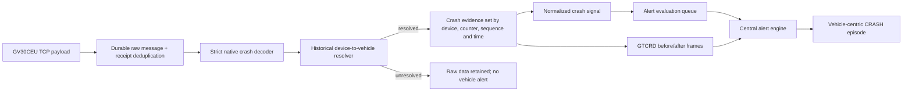

# Phase 5.2 — GV30CEU Signal Catalog and Crash Detection Integration

Date: 2026-11-05  
Scope: PasTrack backend, Queclink GV30CEU native crash signals  
Production changes: none

## Outcome

PasTrack now has a vehicle-centric path for native GV30CEU crash reporting. `GTCRA` is the primary crash trigger. `GTCRD` is supporting reconstruction evidence, and `GTACC` is retained as informational acceleration data without creating an alert. `GTECR` is parsed but remains disabled as a trigger until a real device sample and device configuration are verified.

The implementation never infers a crash from GPS speed, ignition, voltage, battery, or gaps in telemetry. A crash alert can only originate from an accepted native crash message and must resolve through the device assignment history to a `vehicle_id`.

## Evidence and compatibility

The authoritative local protocol reference is `Document/GV30CEU_Develop_Suit_R01A03V21_Eng/protocol/GV30CEU@Track_Air_Interface_Protocol_v0306.pdf`, sections 4.5.24 (`GTCRA`), 4.5.33 (`GTECR`), 4.6.1 (`GTCRD`), and 4.6.2 (`GTACC`). The parser deliberately accepts only protocol version `80201E0306` for these layouts.

Read-only inspection of production raw-message metadata found:

| Signal | Observed count | Status |
|---|---:|---|
| GTCRA | 4 | Verified live; primary crash trigger |
| GTECR | 0 | Documented only; trigger disabled |
| GTCRD | 40 | Verified live; reconstruction evidence |
| GTACC | 412 | Verified live; informational samples |
| GTIGL | 18 | Verified live; no ignition alert |

The observed `GTCRA` messages used counters `00` through `03`, protocol `80201E0306`, and did not contain a valid GPS fix. A sanitized real structure used by the test suite is:

```text
+RESP:GTCRA,80201E0306,000000000000000,,00,0,,,,,,,0510,0001,7D06,0337D716,00,20261105061536,992E$
```

Observed `GTCRD` data used both data types `18` and `19`, five frames per phase, and 1200 hexadecimal characters per frame. Observed `GTACC` data had 900 hexadecimal characters (75 samples of 12 characters). No production payload is reproduced in full.

The database records protocol versions for active devices, but their firmware version is currently null. The presence of the local R01A03V21 development package is not evidence of the firmware installed on live devices.

## Signal catalog

| Signal | Classification | Parser/engine behavior |
|---|---|---|
| GTCRA | Crash trigger | Verified live; creates/evaluates CRASH |
| GTECR | Conditional crash trigger | Parsed; disabled by `gtecr_enabled=false` |
| GTCRD | Supporting evidence | Correlated asynchronously; never creates CRASH alone |
| GTACC | Informational acceleration | Validated and decodable; no alert |
| GTHBM | Harsh behavior | Catalog only |
| GTSPD | Speed event | Catalog only |
| GTTOW | Towing event | Catalog only |
| GTSOS | SOS event | Catalog only |
| GTDIS | Device disconnection | Catalog only |
| GTVGL | Virtual ignition | Existing parser capability; not hardware ignition evidence |
| GTIGL | Ignition event | Observed, but no ignition alert because wiring is not verified |

## Data flow



The event timestamp is the valid device GPS timestamp when a valid fix exists; otherwise it is the device send timestamp. Server receipt time remains provenance and fallback metadata. WIB is a presentation/local-time concern; persisted event instants continue to use the system's UTC convention to avoid ambiguous ordering.

## Correlation and idempotency

- Resolution uses the assignment that was active at the event time, so a later device transfer does not move an old crash to the new vehicle.
- Evidence is correlated by device, crash counter, sequence, message type, and time window (default 600 seconds), not by the two-character counter alone.
- A repeated raw receipt is idempotent.
- Reuse, rollover, or reset of the counter can produce a distinct sequence instead of merging unrelated crashes.
- `GTCRD` may arrive before `GTCRA`; it creates pending evidence only. When the primary signal arrives, the same set is evaluated.
- Evidence becomes complete only when all declared frames for both observed before/after phases are present.
- Supporting evidence updates an active alert's description and provenance; it cannot independently open an alert.
- CRASH has no automatic recovery event.

## Database additions

Migration `013_gv30ceu_crash_signals.sql` adds:

- `queclink_signal_catalog`: explicit signal capability/status inventory.
- `crash_evidence_sets`: correlation identity and reconstruction state.
- `crash_signal_events`: normalized signal/frame records with raw-message provenance.
- CRASH rule configuration with `gtecr_enabled=false`.

The matching rollback is `database/rollbacks/013_gv30ceu_crash_signals.sql`. Migration 013 was applied only to the isolated local test database `pastrack_test_local`; it was not applied to production.

## Important files

| File | Responsibility |
|---|---|
| `internal/protocol/signals.go` | GV30CEU signal catalog and verification status |
| `internal/protocol/crash.go` | Strict GTCRA/GTECR/GTCRD/GTACC decoding and acceleration samples |
| `internal/crash/service.go` | Historical vehicle resolution, correlation, sequencing, evidence persistence |
| `internal/telemetry/types.go` | Normalized crash contract |
| `internal/alertrules/rules.go` | CRASH evaluator and GTECR feature gate |
| `internal/alertengine/engine.go` | Active-episode evidence/provenance enrichment |
| `storage_v2.go` | Receiver integration after durable raw-message commit |
| `database/migrations/013_gv30ceu_crash_signals.sql` | Additive schema and rule/catalog seed |
| `database/rollbacks/013_gv30ceu_crash_signals.sql` | Local/controlled rollback |
| `internal/protocol/crash_test.go` | Protocol fixtures and rejection cases |
| `internal/crash/service_test.go` | Correlation, ordering, deduplication, counter reuse |
| `internal/alertrules/rules_test.go` | Rule trigger/support behavior |
| `storage_v2_test.go` | Receiver-to-normalized-job integration |

## Risks and activation conditions

1. Live firmware inventory is unknown. Confirm the firmware installed on every intended GV30CEU before activation.
2. Crash detection configuration and sensitivity are unknown. Audit device configuration through an approved operational procedure; do not send configuration commands during this phase.
3. `GTECR` has no live sample. Keep it disabled until an authentic payload is captured and validated in a controlled test.
4. A crash may have no GPS fix. The alert must disclose last-known/absent position instead of presenting it as the crash coordinate.
5. Device counters are small and can roll over or reset. Monitoring must retain the sequence/time dimensions.
6. Large GTCRD evidence increases storage volume. Monitor retention, frame completeness, and queue latency.
7. Ignition wiring is not installed/verified. Neither `GTIGL` nor virtual ignition may be presented as confirmed hardware ignition state.

## Components deliberately unchanged

- Existing TCP framing, acknowledgement behavior, durable raw-message storage, and receipt deduplication.
- Existing Phase 3 historical assignment resolver and vehicle identity model.
- Existing Phase 4 centralized alert engine, queue/worker ownership, episode lifecycle, and provenance model; only additive CRASH integration was made.
- Existing GPS telemetry, fuel processing, trip history, dashboard API contracts, and frontend behavior.
- Existing deployment and production database state.

## Recommendation

The code path is ready for controlled validation, not unconditional production activation. Before enabling CRASH in production: inventory firmware/protocol versions, confirm native crash settings and sensitivity, perform a controlled device test that produces GTCRA plus GTCRD evidence, verify historical vehicle assignment and displayed time/location, review retention/operations, then apply migration and deploy through the normal release process. Enable GTECR separately only after live evidence validates its layout and semantics.

